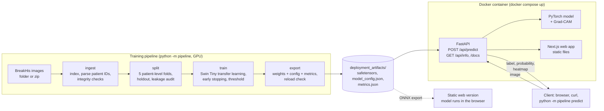

# Breast Histopathology Classifier

DSA 8401 Applied Machine Learning, capstone project. Health informatics track: disease image classification.

This system classifies BreakHis 100X H&E breast tissue images as **benign** or **malignant** with a fine-tuned
**Swin Tiny** vision transformer. It explains each prediction with **Grad-CAM**, and serves the model through a
**FastAPI** service in **Docker** with a web interface.

| | Link |
|---|---|
| FastAPI service and web app (Docker Space) | https://cmaina015-breast-histopathology-api.hf.space · API docs: [`/docs`](https://cmaina015-breast-histopathology-api.hf.space/docs) |
| Static version (the model runs in the browser) | https://cmaina015-breast-histopathology.static.hf.space |

> **Research and education project. Not a medical device and not for clinical diagnosis.**

## Where each deliverable is

| Course requirement | Where |
|---|---|
| Reproducible ML pipeline (ingest → preprocess → train → predict) | [`pipeline/`](pipeline/): `python -m pipeline run`; see [Reproduce from scratch](#reproduce-from-scratch) |
| Model service and deployment (API + Docker) | [`app/`](app/), [`Dockerfile`](Dockerfile), [`docker-compose.yml`](docker-compose.yml); see [Run the API](#run-the-api-with-docker) |
| Training code and serialized artifacts | [`pipeline/train.py`](pipeline/train.py), [`deployment_artifacts/`](deployment_artifacts/) (weights via [`scripts/fetch_weights.py`](scripts/fetch_weights.py)) |
| Architecture diagram | [Architecture](#architecture) |
| Technique justification, including what was ruled out | [Why these techniques](#why-these-techniques) |
| Results and limitations | [Results](#results), [Limitations](#limitations) |
| AI use disclosure | [`AI_USE.md`](AI_USE.md) |
| Slide deck | [`slides/`](slides/) |

## Problem framing

Breast cancer is diagnosed by a pathologist examining H&E-stained biopsy tissue under a microscope. An
automated second opinion could help with triage, where pathologists are scarce, but only if two things hold:
- it works on **patients it has never seen**;
- it can show **what it looked at**.

The task is binary image classification: benign vs. malignant. The output is a probability, a label at a
recall-oriented threshold, and a Grad-CAM heatmap.

### Real-world complications in a public dataset

BreakHis is public, so the project deliberately works with the complications that affect real use:

| Complication | What I did |
|---|---|
| **Patient leakage.** Each of the 81 patients contributes about 26 near-identical images | Every split groups images by patient ID, parsed from the file names. A **leakage audit** of the original random split showed that all 78 test patients also appeared in training, and the ROC-AUC dropped from 0.9995 to 0.962 once patients were kept apart |
| **Class imbalance.** 69% of images are malignant, and only 24 of the 81 patients are benign | The folds are stratified by class. The decision threshold is chosen to keep malignant recall ≥ 0.95, and benign recall is reported separately. Class-weighted loss is tested in [`configs/regularised.json`](configs/regularised.json) |
| **Distribution shift.** Real scanners and settings vary | A **magnification-shift test**: each CV fold's model, trained on 100X, is also scored on its own unseen test patients at 40X, 200X and 400X (`metrics.json → magnification_shift`) |
| **Messy inputs.** Uploads come in any size, format or colour mode | The API validates format and size, decodes like PIL, and warns when the size or aspect ratio is far from the training images |
| **Data integrity** | The ingest stage stops on unparseable names, a folder/label mismatch or a patient in both classes, and it hashes files to find duplicates across patients |

## Architecture



The preprocessing is defined once (`PREPROCESSING` in `model_config.json`). Training, the API and the browser
all rebuild it from that file, so training and serving cannot drift apart.

## Run the API with Docker

```bash
python scripts/fetch_weights.py        # downloads the 110 MB trained weights, SHA-256 checked
docker compose up --build              # http://localhost:7860 (web app) and http://localhost:7860/docs (API)
```

Send an image and get a prediction back:

```bash
curl -F "file=@tissue.png" "http://localhost:7860/api/predict?explain=false"
# {"label": "malignant", "p_malignant": 0.9914, "threshold": 0.3399, "probabilities": {...}, ...}
```

`explain=true` (the default) adds the Grad-CAM heatmap as a base64 PNG, plus the raw 7 × 7 grid. Without
Docker, run `pip install -r requirements.txt`, then `uvicorn app.main:app --host 127.0.0.1 --port 7860`.

## Reproduce from scratch

The training pipeline is scripted. The notebooks in [`notebooks/`](notebooks/) are kept as the exploration
record, and are not needed.

**1. Get the data.** Download BreakHis from the
[official page](https://web.inf.ufpr.br/vri/databases/breast-cancer-histopathological-database-breakhis/).
The pipeline accepts the original folder, a folder with `40X/100X/200X/400X` and `benign/malignant` inside,
or a zip of either.

**2. Install on a GPU machine.** Colab works: use
[`notebooks/run_pipeline_colab.ipynb`](notebooks/run_pipeline_colab.ipynb), which only launches the
commands below.

```bash
pip install -r requirements-train.txt     # with a CUDA build of torch/torchvision already installed
```

**3. Run the pipeline.** It takes about 45 minutes on a T4.

```bash
python -m pipeline run --data-dir /path/to/BreakHis \
    --splits-csv deployment_artifacts/split_assignments.csv \
    --out-dir deployment_artifacts
```

| Stage | Command | Output |
|---|---|---|
| 1. Ingest | `python -m pipeline ingest --data-dir …` | `work/index.csv`, `work/dataset_stats.json`; stops on integrity errors |
| 2. Split | `python -m pipeline split` | `work/splits.csv` (patient-level folds), `work/leakage_audit.json` |
| 3. Train | `python -m pipeline train` | CV folds, leaky baseline, shift test and final model in `work/runs/<run>/`. Resumable |
| 4. Export | `python -m pipeline export` | `safetensors`, `model_config.json`, `metrics.json`, figures. Then reloads them the way the API does and checks the predictions match |
| 5. Predict | `python -m pipeline predict img1.png img2.png --heatmap-dir out/` | JSON predictions (the same code as the API) and Grad-CAM overlays |

- **Configuration:** the defaults in [`pipeline/config.py`](pipeline/config.py) reproduce the deployed model.
  [`configs/regularised.json`](configs/regularised.json) is the regularised alternative; pass it with
  `--config` and a different `--run-name`.
- **Identical folds:** `--splits-csv` reuses the published patient folds. Without it, the folds are rebuilt
  from scratch. They match exactly with scikit-learn 1.6.1, which is pinned in `requirements-train.txt`;
  later versions shuffle `StratifiedGroupKFold` differently.
- **Seeds:** fixed per fold (42 + fold). GPU training is not bit-for-bit deterministic, so re-runs agree
  closely rather than exactly.

## Why these techniques

| Choice | Why | Alternatives ruled out |
|---|---|---|
| **Transfer learning** from ImageNet | 81 patients is far too few to train a deep network from scratch | Training from scratch |
| **Swin Tiny** | It was best of the 10 models in the comparative study, and its hierarchical, windowed attention handles tissue texture at several scales. At 28M parameters it serves on a CPU in about 0.4 s | **Classical ML** on 20 handcrafted features (logistic regression, SVM, random forest, XGBoost) scored lower even on the leaky split (accuracy 0.85–0.94). **CNNs** (ResNet50, EfficientNet, MobileNet) also scored lower. **ViT-Base** scored lower and is 3× larger |
| **Patient-grouped, stratified 5-fold CV** | It is the only honest estimate for a new patient, and stratification keeps both classes in every fold | A random image split, which leaks patients. A single holdout, which would test only about 16 patients |
| **Recall-constrained threshold** (malignant recall ≥ 0.95 on validation) | A missed cancer costs more than a false alarm. The rule is explicit and auditable, and it can be changed without retraining | **Cost-sensitive loss / oversampling:** they shift the decision implicitly, and SMOTE-style synthetic images are not meaningful. Class weights are tested in the tuning config |
| **Grad-CAM** | One backward pass per image, on the model's own last-stage features, so it is cheap enough for every prediction | **SHAP / LIME** on 224×224 images need hundreds to thousands of forward passes and are unstable for pixels. **Attention rollout** is less established for Swin's shifted windows |
| **FastAPI + Docker** | Required by the course. FastAPI also generates interactive docs and validates inputs | Gradio/Streamlit: quicker for demos, but not a real API |
| **Static ONNX version** | Free hosting, and images never leave the user's device | It is not the graded service, but it is verified against it (`scripts/check_browser_parity.py`) |

Also considered and not used:
- **Unsupervised methods and generative AI.** The task is supervised, with expert labels, so they do not fit.
- **Whole-slide / multiple-instance learning.** BreakHis provides image patches, not whole slides.
- **Drift monitoring (e.g. Evidently).** There is no production traffic stream to monitor. The offline
  magnification-shift test stands in for it.
- **MLflow.** The number of runs is small, and each run is recorded in `run_config.json` plus the per-fold
  results in `work/runs/`.

## Results

Patient-level 5-fold cross-validation, mean ± std over the test folds:

| Metric | Deployed rule (p ≥ selected threshold) | Threshold 0.5 |
|---|---|---|
| Malignant recall | 0.938 ± 0.067 | 0.945 ± 0.042 |
| Benign recall | 0.777 ± 0.205 | 0.827 ± 0.094 |
| Balanced accuracy | 0.858 ± 0.086 | 0.886 ± 0.043 |
| ROC-AUC | 0.962 ± 0.032 | 0.962 ± 0.032 |

How to read these numbers:
- **Malignant images are found reliably.** Pooled over the folds, 1,344 of 1,437 were caught.
- **Benign recall is weaker and unstable.** It ranges from 0.55 to 0.98 by fold, because each fold holds
  only a few benign patients.
- **The threshold choice did not help.** The thresholds chosen on small validation sets (0.07 to 0.98) did
  slightly worse on average than a fixed 0.5. The probabilities are over-confident, which is the overfitting
  the regularised config targets.
- **The random split overstated performance.** The leaky image-level split reached ROC-AUC 0.9995, because
  all 78 of its test patients were also in training. That number is kept only as a labelled baseline.
- **Magnification shift:** the pipeline scores each fold's model on 40X, 200X and 400X images and writes
  the results to `metrics.json → magnification_shift`. The deployed artifacts were exported from the
  original training notebook, before this test was added, so they do not include these results yet.

## Limitations

- **Small data.** 81 patients from one institution, at one magnification, with no external test set.
- **Threshold.** The threshold is fitted to a few validation patients and varies widely between folds.
- **Explanations.** Grad-CAM works on a 7 × 7 grid (32 × 32-pixel regions). It sometimes highlights
  non-diagnostic fat tissue, so it shows where the model looked, not why.
- **No out-of-distribution check.** The model labels any image, even one that is not histology.
- **Level of prediction.** Predictions are per image; there is no patient-level aggregation.

## Deployment details

- **Docker Space** (`CMaina015/breast-histopathology-api`): the `Dockerfile` builds the web app in server
  mode (`NEXT_PUBLIC_INFERENCE=server`), so its Analyze page posts images to FastAPI. To redeploy, run
  `scripts/deploy_docker_space.py`. Hugging Face requires a PRO account for Docker Spaces.
- **Static Space:** `scripts/export_onnx.py` exports the model to ONNX, with Grad-CAM written in closed form
  because browsers cannot back-propagate. `scripts/export_static.py` writes the site data,
  `cd web && npm run build` builds the site, and `scripts/deploy_static_space.py` publishes it. The parity
  checks are:

| Script | What it checks | Result |
|---|---|---|
| `scripts/export_onnx.py` | ONNX vs PyTorch and pytorch-grad-cam | probability diff ≤ 1e-7, CAM diff ≤ 1.3e-5 |
| `scripts/check_resize.py` | TypeScript resize vs Pillow, 12 sizes | identical bytes |
| `scripts/check_browser_parity.py` | the browser vs the FastAPI app, on 17 files | same labels and warnings, probability diff ≤ 5e-8 |

## Testing and CI

```bash
pip install -r requirements-dev.txt pandas==2.3.3 tqdm==4.70.1
python -m pytest tests -q          # 29 tests: API, input handling, pipeline splits and threshold logic
```

[`.github/workflows/ci.yml`](.github/workflows/ci.yml) runs the tests, lints and builds the web app, and
builds the Docker image on every push.

## Repository layout

```
pipeline/            scripted training pipeline (ingest, split, train, export, predict)
configs/             run configurations (baseline = deployed model, regularised)
app/                 FastAPI service: input validation, prediction, Grad-CAM
deployment_artifacts/  trained model config, metrics, figures, patient splits (weights: fetch_weights.py)
tests/               pytest suite
web/                 Next.js + Tailwind web app (Analyze, Pipeline, Data pages)
scripts/             weights download, ONNX export, parity checks, Space deployment
notebooks/           exploration: comparative study, original training notebook, tuning, Colab launcher
Dockerfile, docker-compose.yml, .github/workflows/ci.yml
```

## Data

BreakHis: Spanhol, F. A., Oliveira, L. S., Petitjean, C., Heutte, L. "A Dataset for Breast Cancer
Histopathological Image Classification." *IEEE Transactions on Biomedical Engineering*, 63(7), 2016.
The images are not included in this repository. Download them from the official page.
